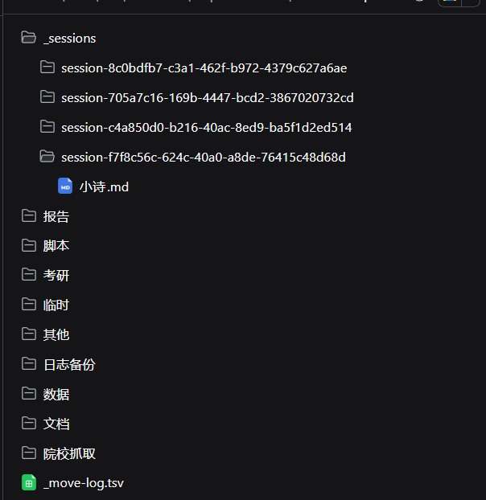
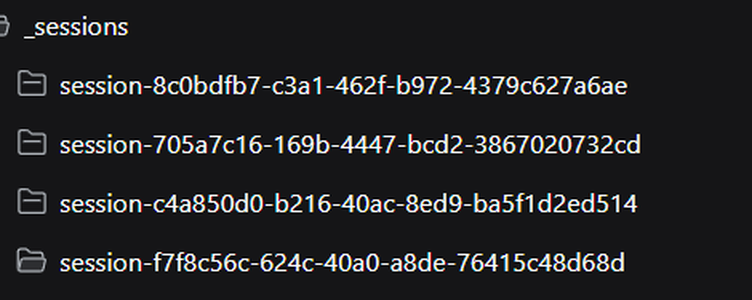

# dsh-session-isolation

[中文说明](README.zh-CN.md)

Give every **new session** in a chosen DeepSeek Harness workspace its own working
directory — without turning each session into a separate workspace.

`@local/dsh-session-isolation` is a local DSH bundle with two halves:

- **Host** — listens to `agent/created`; when a session starts (`startup`) or gets
  a fresh conversation (`clear`) inside one of the configured workspaces, it
  creates `<workspace>\<baseDir>\<session-id>` and switches the session's
  `working-directory` projection to that directory.
- **Browser** — adds a folder button to the conversation header (next to DSH's
  built-in "Open in…" split button) that opens the session directory in the OS
  file manager, and repairs file addresses that DSH builds against the stale
  workspace root (v1.2.0).

Session ownership never changes: `SessionHeader.cwd` stays the workspace root, so
the sidebar keeps grouping the session under its original workspace.

```text
default-workspace\
├─ _sessions\                    ← one folder per new session
│  ├─ session-8c0bdfb7-…\
│  │  └─ poem.md
│  └─ session-f7f8c56c-…\
└─ …                             ← existing workspace files, untouched
```

## Features

- **Per-session working directory** — agents start in `_sessions\<session-id>`
  and only write there unless they explicitly go elsewhere.
- **No workspace surgery** — no new workspace entries, no `SessionHeader` rewrite,
  no changes to DSH's profile or workspace registry.
- **New sessions only** — `startup` and `clear` are isolated; `resume` and
  `compact` keep whatever the projection already replays.
- **Subagents included by default** — every subagent session gets its own folder
  (can be turned off).
- **Never blocks a session** — any isolation failure is logged as a warning and
  the session silently keeps the workspace root.
- **Header button only where it makes sense** — it queries a read-only Host route
  instead of guessing a path, and stays hidden for sessions that are not isolated.
- **Client-side address repair (v1.2.0)** — file links and file cards in chat open
  correctly in the document preview even though the working directory is no
  longer the workspace root.

## Screenshots

The folder button added by the bundle, right of DSH's built-in "Open in…" split
button:


The files panel browsing the same workspace — every session folder lives under
`_sessions`:





## Requirements

- DSH Desktop **0.2.1-rc.2 or later** (tested on 0.2.1-rc.2 and 0.2.1-rc.3).
- The profile enables `@deepseek-ai/dsh-working-directory` and the browser module
  system — both are on by default in the desktop build.
- Windows was the primary target; the Host half uses only `node:` built-ins and
  `path` semantics, so other platforms work as long as the configured workspace
  paths are absolute.

## Install

The package is **not published to npm**. DSH links a local bundle into the current
profile and mounts the Host row declared by the bundle's own `cordis.patch.yml`.

1. Clone this repository into a stable directory, for example
   `D:\dsh-session-isolation`.
2. Edit [`cordis.patch.yml`](cordis.patch.yml): replace the example
   `workspaces` entry with your own workspace root (absolute path; write doubled
   backslashes in YAML on Windows).
3. Install the folder as a bundle and restart DSH Desktop:
   - DSH Desktop → **Plugins** → install a bundle from a folder → select this
     directory; or
   - from a DSH session that exposes the plugin manager:
     `plugin_manager install_bundle target=<repo path>`

A local install is a **link**: DSH uses the folder in place, so keep it where it
is (moving or deleting it disables the plugin).

## Configuration

The inserted `session-isolation` row in `cordis.patch.yml`:

| Field | Type | Default | Meaning |
| --- | --- | --- | --- |
| `workspaces` | `string[]` | required | Absolute workspace roots. Only sessions whose `header.cwd` equals one of them are isolated. |
| `baseDir` | `string` | `_sessions` | Directory name under each workspace. Relative paths are resolved per workspace; absolute paths are used as-is. |
| `isolateSubagents` | `boolean` | `true` | Also give subagent sessions their own directory. |

Invalid configuration makes the plugin fail at activation (the row shows as
failed) instead of silently doing nothing.

## How it works

### Host side

`agent/created` is a serial event: DSH awaits every listener before the session
creation transaction resolves, and a listener that throws aborts creation. The
bundle therefore treats isolation as best-effort — the whole routine is wrapped in
`try/catch`, failures only produce a `warn` log line, and the session keeps the
workspace root.

It only acts when `source` is `startup` or `clear`, and only for sessions whose
`header.cwd` matches a configured workspace. It never overrides a directory that
another mechanism already set (`startup` skips when the current directory is
neither the workspace root nor the service default).

### Header button

The button never guesses: it asks the Host, then reuses DSH's own file-manager
routes.

```text
GET /session-isolation/session-directory?sessionId=<id>
  -> 200 {"sessionId": "...", "directory": "<workspace>\\_sessions\\<id>"}   isolated
  -> 404                                                                     not isolated / deleted
```

The route shares the web server's trust fence (`connection.requestRejection`,
i.e. DSH's Host/Origin check plus browser auth), answers `405` for non-`GET` and
`400` without a session id. Once a path is returned, the browser half calls the
profile's own `GET /open-in-app/apps` and `POST /open-in-app/open`; on Windows
that is File Explorer.

### File-address repair (v1.2.0)

DSH's browser code assumes *session working directory == workspace root*. With an
isolated session that assumption can produce two kinds of broken file addresses:

- **missing separator** — `.../default-workspace_sessions/session-<id>/a.md`
  (workspace root glued to `baseDir`);
- **working-directory-relative** — `a.md`, which the Host then resolves against
  the workspace root and misses.

The browser half wraps `sidebarRight.openResource` and fixes both before opening:
it inserts the missing `/` when a known workspace root is glued to `baseDir`, and
prefixes relative paths with `<baseDir>/<session-id>/` once the Host confirms the
session is isolated. Repair only applies to configured-workspace, isolated
sessions; every other address passes through untouched. The wrapper is idempotent,
routes to the original method, and never throws.

Only newly opened files are repaired — tab addresses persisted by an older build
are not rewritten, so click the file once after upgrading.

Changing `index.js` or `client.js` requires restarting DSH Desktop: the browser
half is served from `exports["./client"]` by the client module system and is
composed at boot.

## Verification

1. A new session's log (`session.v4.jsonl.zstd`) contains a
   `working-directory/change` event pointing at `_sessions\<session-id>`.
2. The system prompt shows `Current working directory: <workspace>\_sessions\<id>`.
3. Sessions in other workspaces never get an `_sessions` directory.
4. Resuming an old session adds no `working-directory/change` event.
5. The header folder button appears and opens the session folder in the file
   manager.
6. Clicking a file link/card inside an isolated session opens the document
   preview (v1.2.0 fix).

## Compatibility

Tested with DSH **0.2.1-rc.2** and **0.2.1-rc.3** on Windows 11. The bundle only
uses public, stable contracts and patches no DSH internals:

- Host: `agent/created` (serial, awaited listener), the `workingDirectory`
  service, `webServer.register` + `connection.requestRejection`, `sessions.get`.
- Browser: `dsh.client` packaging (`exports["./client"]` →
  `/plugins/<name>/client.js`), the `conversation.session.header.utilities` slot,
  the `slots` / `locale` / `sessions` services, and DSH's `/open-in-app` routes.

Behaviour of the host and client contracts above was re-checked against
0.2.1-rc.3 (working directory service, `agent/created` signature, slot
registration, file-address grammar, `/open-in-app` body validation) — no code
changes were required. Runtime dependencies: none (Node built-ins only).

## Notes

- The plugin never changes sandbox, approval or permission settings. On Windows,
  DSH's own sandboxed shell can have environment-specific issues in some builds
  (e.g. console child processes under `workspace-write`, or a bundled PowerShell
  without its `Modules` directory); those are unrelated to this bundle.
- Deleting a session may leave an empty `_sessions\<id>` folder behind; nothing
  cleans it up automatically.
- A `_sessions` folder can be deleted at any time — the session falls back to the
  workspace root.

## Uninstall

Disable the `session-isolation` row in the plugin manager to stop isolating new
sessions, or remove the whole bundle. Existing sessions and their `_sessions`
folders are unaffected and can be deleted by hand.

## Development

- `index.js` — Host half (isolation + read-only directory route).
- `client.js` — browser half (header button + address repair), served via
  `exports["./client"]`.
- `cordis.patch.yml` — the Host row inserted by the bundle.
- `locale/`, `icon.svg` — plugin-manager display metadata.

## License

MIT — see [LICENSE](LICENSE).
