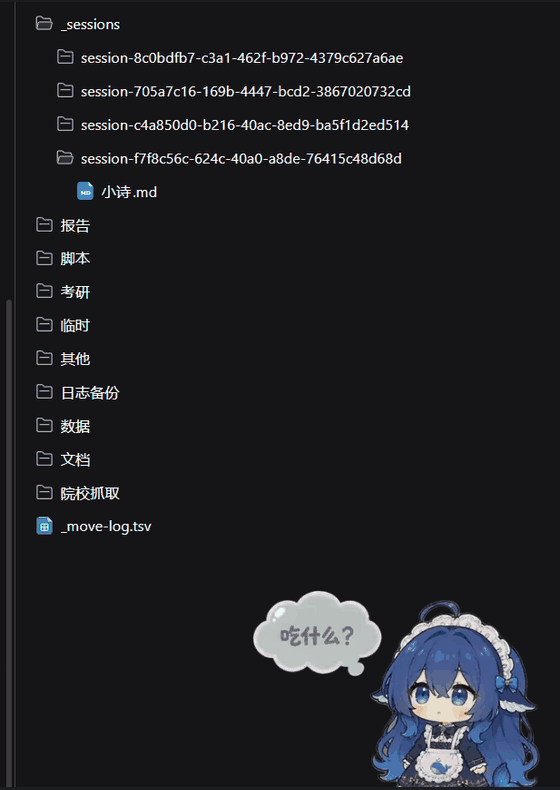

# dsh-session-isolation

[English](README.md)

为 DeepSeek Harness 指定工作区里的每个会话分配独立工作目录：新会话直接进入自己的
目录，已有会话在首次打开时也会分配，而不必把每个会话变成一个独立工作区。

`@local/dsh-session-isolation` 是一个本地 DSH bundle，分 Host 与浏览器两半：

- **Host**：监听 `agent/created`；当会话在配置的工作区里启动（`startup`）、重开
  新对话（`clear`），或首次恢复一个仍在工作区根的已有会话时，创建 `<workspace>\<baseDir>\<session-id>`，并把该会话的
  `working-directory` 投影切到该目录。
- **浏览器**：在会话头部（DSH 内置的「在应用中打开」分体按钮旁）加一个文件夹按钮，
  点击用系统文件管理器打开当前会话目录；v1.2.0 起还会修正 DSH 按旧工作区根生成的
  文件地址。

会话归属不变：`SessionHeader.cwd` 仍是工作区根，所以侧栏仍把会话分组在原工作区下。

```text
default-workspace\
├─ _sessions\                    ← 每个新会话一个目录
│  ├─ session-8c0bdfb7-…\
│  │  └─ poem.md
│  └─ session-f7f8c56c-…\
└─ …                             ← 原有工作区文件不受影响
```

## 功能

- **会话级工作目录**：代理默认在 `_sessions\<session-id>` 里工作，不会再把文件写到
  工作区根。
- **不动工作区结构**：不新增工作区、不改 `SessionHeader`、不写 profile 或
  workspace 注册表。
- **已有会话也覆盖**：仍在工作区根的会话在首次进入时分配目录（新会话、清空后的会话、
  安装插件后首次恢复的旧会话）；已有自己工作目录（含 `_sessions` 目录）的会话不会被移动。
- **子代理默认同样隔离**：每个子代理会话也有自己的目录（可关闭）。
- **绝不阻断会话**：隔离过程任何异常只写 warn 日志，会话继续使用工作区根。
- **按钮只出现在该出现的会话**：按钮不猜路径，而是向 Host 只读路由查询；未隔离的
  会话不显示按钮。
- **浏览器端地址纠错（v1.2.0）**：工作目录不再是工作区根时，聊天里的文件链接/文件卡
  在右侧文档预览里也能正常打开。

## 截图

bundle 新增的文件夹按钮（位于 DSH 内置「在应用中打开」分体按钮右侧）：


同一个工作区的文件面板——每个会话目录都在 `_sessions` 下：


文件面板的动态演示（放大到 `_sessions`，每个隔离会话一个目录）：



## 要求

- DSH 桌面版 **0.2.1-rc.2 或更新**（已在 0.2.1-rc.2、0.2.1-rc.3、
  0.2.1-rc.5 上验证）。
- profile 启用了 `@deepseek-ai/dsh-working-directory` 与浏览器模块系统——桌面版默认
  都开启。
- 主要面向 Windows；Host 侧只用 `node:` 内置模块与 `path` 语义，其他平台只要配置的
  工作区路径是绝对路径即可。

## 安装

本包**不在 npm 发布**。DSH 插件管理器把本目录链接进当前 profile，并挂载 bundle 自带
`cordis.patch.yml` 声明的 Host 行。

1. 把本仓库放到固定目录，例如 `D:\dsh-session-isolation`。
2. 编辑 [`cordis.patch.yml`](cordis.patch.yml)，把 `workspaces` 的示例路径换成你的
   工作区根（绝对路径；Windows 路径在 YAML 里写双反斜杠）。
3. 用插件管理器安装本目录，然后重启 DSH 桌面版：
   - 桌面版 → **插件** → 从本地目录安装 bundle → 选择本目录；或
   - 在带插件管理器的 DSH 会话里：
     `plugin_manager install_bundle target=<本仓库目录>`

本地安装是**链接**：DSH 直接使用该目录，移动或删除目录即停用插件。

## 配置

`cordis.patch.yml` 里插入的 `session-isolation` 行：

| 字段 | 类型 | 默认值 | 说明 |
| --- | --- | --- | --- |
| `workspaces` | `string[]` | 必填 | 绝对路径；只有 `header.cwd` 与其中一项相等的会话才会被隔离 |
| `baseDir` | `string` | `_sessions` | 相对路径时相对每个 workspace，绝对路径时直接使用 |
| `isolateSubagents` | `boolean` | `true` | 为子代理会话也创建独立目录 |

配置非法时插件在激活阶段直接报错（行显示失败），不会静默失效。

## 工作原理

### Host 侧

`agent/created` 是串行事件：DSH 会等所有监听器完成后才提交会话创建，监听器抛错会中止
创建。因此隔离是「尽力而为」——整个过程包在 `try/catch` 里，失败只写一行 warn，会话
继续使用工作区根。

只要 `header.cwd` 命中配置工作区、且会话仍在工作区根就动作（`startup` / `clear` /
`resume` / `compact` 都可能触发）；已经回放出自己工作目录的会话（`_sessions` 目录或
用户移动后的目录）不会被改动，因此每个会话只隔离一次。

### 头部按钮

按钮不猜路径，先问 Host，再复用 DSH 自带的文件管理器路由：

```text
GET /session-isolation/session-directory?sessionId=<id>
  -> 200 {"sessionId": "...", "directory": "<workspace>\\_sessions\\<id>"}   已隔离
  -> 404                                                                    未隔离 / 目录已删
```

路由与 Web 服务共用信任栅栏（`connection.requestRejection`，即 Host/Origin 检查 +
浏览器鉴权），非 `GET` 返回 405，缺 `sessionId` 返回 400。拿到目录后，浏览器半侧调用
profile 自带的 `GET /open-in-app/apps` 与 `POST /open-in-app/open`；Windows 下即资源
管理器。

### 文件地址纠错（v1.2.0）

DSH 浏览器端假设「会话工作目录 == 工作区根」。隔离会话里这可能生成两类坏地址：

- **缺分隔符**：`.../default-workspace_sessions/session-<id>/a.md`（工作区根与
  `baseDir` 粘在一起）；
- **按工作目录取相对路径**：`a.md`，Host 却按工作区根解析成 `<workspace>\a.md`。

浏览器半侧会包一层 `sidebarRight.openResource`，在打开前修正这两类地址：已知工作区根
与 `baseDir` 粘连时补 `/`；相对路径且 Host 确认会话已被隔离时补成
`<baseDir>/<session-id>/<路径>`。只对「配置工作区 + 已隔离」的会话生效，其他地址原样
放行；包装幂等、出错不抛。

注意：只修复重启后新打开的文件；旧版本已持久化的坏 tab 地址不会自动改写，重新点一次
文件即可。修改 `index.js` / `client.js` 后需要重启 DSH 桌面版（浏览器半侧由模块系统在
启动时按 `exports["./client"]` 组合）。

## 验证

1. 会话日志 `session.v4.jsonl.zstd` 出现 `working-directory/change`，`cwd` 指向
   `_sessions\<session-id>`。
2. 系统提示里 `Current working directory` 是该目录。
3. 其他工作区的新会话不产生 `_sessions` 目录。
4. 恢复已有自己目录的会话不追加 `working-directory/change` 事件；恢复仍在工作区根的
   会话会追加一条并得到目录。
5. 会话头部出现文件夹按钮，点击后文件管理器打开该会话目录。
6. 隔离会话里点聊天中的文件链接/文件卡，右侧预览正常打开（v1.2.0 起）。

## 兼容性

已在 DSH **0.2.1-rc.2**、**0.2.1-rc.3** 与 **0.2.1-rc.5**（Windows 11）上验证。
只使用公开、稳定的契约，不 patch DSH 内部：

- Host：`agent/created`（串行、被 await 的监听器）、`workingDirectory` 服务、
  `webServer.register` + `connection.requestRejection`、`sessions.get`。
- 浏览器：`dsh.client` 打包约定（`exports["./client"]` →
  `/plugins/<name>/client.js`）、`conversation.session.header.utilities` 槽、
  `slots` / `locale` / `sessions` 服务，以及 DSH 的 `/open-in-app` 路由。

上述 host/client 契约已对照 0.2.1-rc.3 复核，并于 2026-10-30 再次对照 0.2.1-rc.5
复核（working directory 服务、`agent/created` 签名、`webServer.register` +
`connection.requestRejection`、槽注册——bundle 的头部按钮已注册且处于 active、文件地址
语法、`/open-in-app` 请求体校验均无变化）——无需改代码。v1.2.2（2026-10-30）起，
对仍在工作区根的 **resume** 会话也执行隔离，已有会话在安装后首次打开时即可获得目录；
已在 0.2.1-rc.5 上验证。v1.2.3（2026-10-30）起，头部按钮在查不到目录时会重试数秒、且不缓存
“未隔离”结果，窗口启动时被恢复的会话也能无刷新拿到按钮。运行时无第三方依赖，只用 `node:`
内置模块。

## 说明

- 插件不改变沙箱、审批或权限设置。Windows 上 DSH 自带的沙箱 shell 在个别版本可能有
  环境相关问题（如 `workspace-write` 下控制台子进程启动失败、内置 PowerShell 缺少
  `Modules` 目录），与本品无关。
- 删除会话可能留下空的 `_sessions\<id>`，不会自动清理。
- `_sessions` 目录可随时删除，会话回退到工作区根；下次进入时会自动重建。

## 停用 / 卸载

插件管理器中禁用 `session-isolation` 行即可停止隔离生效；移除整个 bundle 亦可。
历史会话与其 `_sessions` 目录不受影响（目录可手工删除）。

## 开发

- `index.js`：Host 半侧（隔离 + 只读目录路由）。
- `client.js`：浏览器半侧（头部按钮 + 地址纠错），经 `exports["./client"]` 提供。
- `cordis.patch.yml`：bundle 插入的 Host 行。
- `locale/`、`icon.svg`：插件管理器显示元数据。

## License

MIT，见 [LICENSE](LICENSE)。
